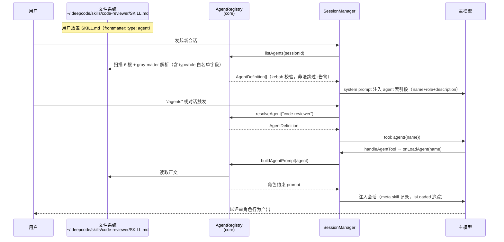
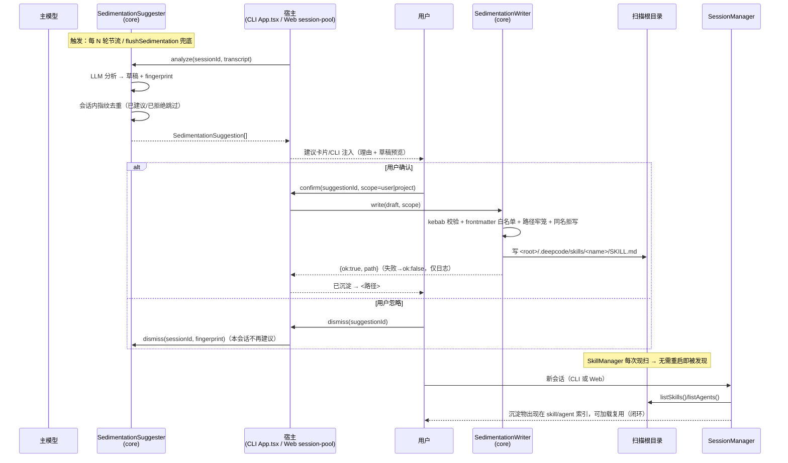

# 架构设计：Agent 自定义 + Skill/Agent 自动发现沉淀 + Web 多工作空间

- **日期**：2026-10-27
- **作者**：架构师 高见远（Gao）
- **依据**：`docs/prd/PRD-20261027-agent-autodiscovery.md` + `docs/research/dsh-analysis-20261027.md` + 主理人决策 Q1~Q6
- **状态**：定稿（供工程师直接执行）

---

## 1. 实现方案与技术选型

### 1.1 总体原则

Karpathy 四原则落地：**复用优先**（自定义 Agent 完全寄生在既有 SkillManager 扫描/去重/启用链上；沉淀复用 EagDynamicSuggester 通道 + MemoryStore 沉淀兜底时机）；**最小代码**（P0 不引入子会话、不引入事件总线、零新依赖）；**精准修改**（core 为唯一能力源，cli/web 仅薄封装）；**目标驱动**（每条 PRD 验收标准映射到任务验收项）。

### 1.2 四个决策点的定夺

**D1（Q1）定义载体 = SKILL.md + frontmatter 扩展。**
自定义 Agent 是「带角色约束的指令资产」，与 skill 同目录（既有 6 个扫描根零改动）、同加载链、同 `enabledSkills` 开关。frontmatter 新增 `type: agent` 与可选 `role`/`tools`。dsh 佐证：dsh 自己的 skill 发现层与 DeepCodeX SkillManager 高度同构（rank 分层 + 重名获胜 + kebab-case + frontmatter 白名单化），而 dsh 的组合式 Agent 定义（YAML 插件列表 + persona）是 Cordis 世界的产物，在 DeepCodeX 属过度设计。

**D2（Q2）执行模型 = P0 会话内 prompt 注入，不做独立子会话。**
dsh 的独立子会话代价是 session 生命周期 / activation 管理 / 委派深度 / 结果回传 / 冷恢复一整套（仅 `subagent` Service Definition 即 657 行 + 20 个源文件）。P0 的自定义 Agent 本质是「角色化指令注入」，与 skill 加载同构，复用 `onLoadSkill` 同款通道（新增 `onLoadAgent`，注入时打 `meta.skill` + agent 标记即可被既有 isLoaded 追踪覆盖）。独立子会话留待 P2，届时须先补齐 dsh 证明缺一不可的三件套：深度上限、preset 白名单、结构化结果。

**D3（Q3）沉淀流程 = LLM 草稿 + 用户确认 + 白名单校验落盘。**
dsh 无此机制（全库零命中，记忆外置 MCP），DeepCodeX 的 EagDynamicSuggester「分析 → 建议 → 用户处置」管道是独有优势。新增 `SedimentationSuggester`（LLM 分析对话产出草稿）与 `SedimentationWriter`（确认后落盘），触发点对齐 MemoryStore 既有沉淀时机（轮次节流 + `flushSedimentation` 兜底）。

**D4（Q4）Web 多工作空间 = 显式 `web.workspaces` 配置节 + 服务端强校验 + 前端切换器。**
凭据防线（R5：个人区不得成为凭据来源；项目级 settings 在 personalOnly 下 `ignoreProjectSettings=true`）**一字不动**：多空间仅扩大「projectRoot 可选集合」，工程数据根仍按 projectCode 落 `engineHomeRoot`，个人区隔离规则照旧。约束链：`personalOnly=true` → workspace.root 必须位于个人区内；`personalOnly=false` → root 必须位于 allowRoots 白名单内。启动期 fail-fast 校验。

### 1.3 复用 / 新增 / 改动清单

| 类别 | 内容 |
|---|---|
| **复用（零改动）** | SkillManager 扫描根与去重、`enabledSkills`、gray-matter、zod 工具校验、`resolveInJail`/`buildJailRoots` 牢笼、`getProjectCode` 会话隔离、SSE 事件桥、MemoryStore 沉淀兜底、`common/sediment-logger.ts` 结构化日志 |
| **新增（core）** | `AgentRegistry`（Agent 发现/索引/注入 prompt）、`agent` 工具、`SedimentationSuggester`、`SedimentationWriter` |
| **新增（cli/web）** | `/agents` slash、Web 工作空间 API + `WorkspaceSwitcher`、沉淀建议卡片 |
| **修改** | `SkillInfo` 类型扩展、`readSkillInfo` 解析扩展字段、skill 目录索引分区、工具注册表、`session-pool.createChat`、web config 解析、CLI slash-commands |

### 1.4 架构模式

沿用仓库既定模式，不新造：

- **单一装配源**（`eag/assembly.ts` 先例）：全部新能力经 `packages/core/src/index.ts` 导出工厂与类型，CLI（App.tsx 装配）与 Web（session-pool 装配）各自注入，core 不感知宿主。
- **失败安全**：所有新组件构造/执行异常 → try/catch 隔离 + `sediment-logger` 结构化日志 + 功能降级（Agent 列表为空、无沉淀建议），宿主主流程不崩溃。

---

## 2. 文件列表（相对仓库根，⭐=新增，✏️=修改）

### core（能力源）

| 文件 | 变更 | 说明 |
|---|---|---|
| `packages/core/src/session.ts` | ✏️ | `SkillInfo` 增加 `kind: "skill" \| "agent"`、`role?`、`tools?`；SessionManager 增加 `onLoadAgent` 装配点与 `loadAgentForTool()`（镜像 `loadSkillForToolBatch`）；agent 索引段注入 system prompt |
| `packages/core/src/skill-manager.ts` | ✏️ | `readSkillInfo` 解析 `type`/`role`/`tools`（白名单字段，未知字段丢弃）；`listSkills()` 输出 kind；新增 `listSkills(kind?)` 过滤重载 |
| `packages/core/src/agents/agent-registry.ts` | ⭐ | `AgentRegistry`：包装 SkillManager，`listAgents()` / `resolveAgent()` / `buildAgentPrompt()` / `buildAgentIndexPrompt()`（kebab-case 校验、frontmatter 白名单、目录摘要只含 name+description+role） |
| `packages/core/src/agents/sedimentation-writer.ts` | ⭐ | `SedimentationWriter`：确认后落盘（scope 校验、kebab-case、frontmatter 白名单、路径牢笼、同名拒写） |
| `packages/core/src/agents/index.ts` | ⭐ | 导出 agents 模块公共 API |
| `packages/core/src/eag/dynamic/sedimentation-suggester.ts` | ⭐ | `SedimentationSuggester`：LLM 分析对话 → `SedimentationSuggestion[]` 草稿（含指纹、节流、会话内去重） |
| `packages/core/src/eag/dynamic/prompts/sedimentation-prompt.ts` | ⭐ | 沉淀分析 prompt 模板（输出 JSON schema 约束） |
| `packages/core/src/eag/dynamic/index.ts` | ✏️ | 导出新类型 |
| `packages/core/src/tools/agent-handler.ts` | ⭐ | `handleAgentTool`（镜像 skill-handler，zod 校验，走 `onLoadAgent`） |
| `packages/core/src/tools/executor.ts` | ✏️ | 注册 `agent` 工具（:161 旁） |
| `packages/core/src/tools/schemas.ts`（工具 schema 声明处） | ✏️ | `agent` 工具 schema + 描述 |
| `packages/core/src/index.ts` | ✏️ | 导出 agents 模块、suggester/writer 类型与工厂 |
| `packages/core/src/tests/agent-registry.test.ts` | ⭐ | Agent 定义解析/覆盖/非法 frontmatter 单测 |
| `packages/core/src/tests/agent-tool.test.ts` | ⭐ | agent 工具注入与追踪单测 |
| `packages/core/src/tests/sedimentation-writer.test.ts` | ⭐ | 落盘校验/路径牢笼/同名拒写单测 |
| `packages/core/src/tests/sedimentation-suggester.test.ts` | ⭐ | 草稿解析/指纹去重/失败隔离单测 |

### cli（薄封装）

| 文件 | 变更 | 说明 |
|---|---|---|
| `packages/cli/src/ui/core/slash-commands.ts` | ✏️ | 新增 `/agents`（列表与调用，镜像 `/skills`） |
| `packages/cli/src/ui/components/AgentsDropdown/index.tsx` | ⭐ | Agent 选择下拉（镜像 SkillsDropdown） |
| `packages/cli/src/ui/views/App.tsx` | ✏️ | 装配 AgentRegistry / SedimentationSuggester；建议经既有建议注入通道呈现，确认/忽略回调 |
| `packages/cli/src/tests/agents-slash.test.ts` | ⭐ | slash 列表/调用/降级测试 |

### web 后端

| 文件 | 变更 | 说明 |
|---|---|---|
| `packages/web/src/config.ts` | ✏️ | 解析校验 `web.workspaces`（启动期 fail-fast：root ⊆ 个人区或 allowRoots；root ≠ uploadDir） |
| `packages/web/src/types.ts` | ✏️ | `ResolvedWebSettings.workspaces` |
| `packages/web/src/api/workspace-api.ts` | ⭐ | `GET /api/workspaces`（返回当前用户可用空间列表） |
| `packages/web/src/api/chat-api.ts` | ✏️ | createChat 接受 `workspaceId`/projectRoot ∈ 可用空间集合（复用 resolveInJail） |
| `packages/web/src/api/sedimentation-api.ts` | ⭐ | `GET /api/sedimentation/suggestions`、`POST /api/sedimentation/confirm`、`POST /api/sedimentation/dismiss` |
| `packages/web/src/session-pool.ts` | ✏️ | createChat 空间绑定校验；装配 Suggester/Writer（单一装配源）；轮次结束触发分析；SSE 推送建议事件 |
| `packages/web/src/server.ts` | ✏️ | 挂载新路由 |
| `packages/web/src/tests/workspaces.test.ts` | ⭐ | 白名单/越权 403/牢笼回归测试 |

### web 前端（`packages/web/web/src`）

| 文件 | 变更 | 说明 |
|---|---|---|
| `components/WorkspaceSwitcher.tsx` | ⭐ | 侧边栏顶部空间切换器（PRD §5.1） |
| `components/SedimentationCard.tsx` | ⭐ | 沉淀建议卡片（预览/确认/忽略，PRD §5.3） |
| `components/SessionSidebar.tsx` | ✏️ | 挂 WorkspaceSwitcher，会话列表按空间过滤 |
| `components/ChatPane.tsx` | ✏️ | 渲染 SedimentationCard |
| `api.ts` | ✏️ | workspaces / sedimentation 端点封装 |
| `chat-model.ts` / `sse.ts` | ✏️ | 建议事件类型 |

---

## 3. 数据结构与接口定义（签名级）

```ts
// ===== core/src/session.ts（修改）=====
export type SkillInfo = {
  name: string;
  path: string;
  description: string;
  isLoaded?: boolean;
  allowImplicitInvocation?: boolean;
  /** 新增：条目种类，frontmatter `type` 缺省视为 "skill" */
  kind?: "skill" | "agent";
  /** 新增：agent 专属——一句话角色身份（frontmatter `role`） */
  role?: string;
  /** 新增：agent 专属——工具白名单声明（P0 仅透传展示，不收窄权限） */
  tools?: string[];
};

// SessionManager 新增装配点（镜像 onLoadSkill）
type SessionManagerDeps = {
  // ...既有
  onLoadAgent?: (sessionId: string, name: string) => Promise<boolean>;
};

// ===== core/src/agents/agent-registry.ts（新增）=====
export interface AgentDefinition extends SkillInfo {
  kind: "agent";
  role: string;              // 缺省回退 description 首句
  body: string;              // SKILL.md 正文（行为约束）
}

export class AgentRegistry {
  constructor(deps: {
    projectRoot: string;
    getResolvedSettings: () => { enabledSkills?: Record<string, boolean> };
  });
  /** 扫描全部根，仅返回 kind==="agent" 条目（同名覆盖规则与 skill 一致） */
  listAgents(sessionId?: string): Promise<AgentDefinition[]>;
  /** 按名解析；未找到/被禁用返回 undefined */
  resolveAgent(name: string): Promise<AgentDefinition | undefined>;
  /** 单个 agent 注入 prompt（正文 + 角色前后缀包装） */
  buildAgentPrompt(agent: AgentDefinition): string;
  /** system prompt 索引段：名称 + role + description（无正文、无绝对路径） */
  buildAgentIndexPrompt(agents: AgentDefinition[]): string;
  /** kebab-case 校验：^[a-z0-9]+(?:-[a-z0-9]+)*$ */
  isValidAgentName(name: string): boolean;
}

// ===== core/src/agents/sedimentation-writer.ts（新增）=====
export type SedimentationScope = "user" | "project";
export type SedimentationDraft = {
  kind: "skill" | "agent";
  name: string;              // kebab-case
  description: string;       // 必填非空
  role?: string;             // kind==="agent" 时必填
  content: string;           // Markdown 正文
};
export type WriteResult =
  | { ok: true; path: string }
  | { ok: false; reason: "invalid-name" | "invalid-frontmatter" | "path-escapes-root"
      | "duplicate-name" | "io-error"; message: string };

export class SedimentationWriter {
  constructor(deps: { projectRoot: string; log?: SedimentLogFn });
  /**
   * 安全落盘。约束（Q5 安全门槛）：
   * 1. 仅接受 Draft 白名单字段，其余一律丢弃；
   * 2. name 必须过 kebab-case；
   * 3. 目标目录限定 <home>/.deepcode/skills/<name>/ 或
   *    <projectRoot>/.deepcode/skills/<name>/，resolve 后必须位于根内（防穿越）；
   * 4. 同名已存在 → duplicate-name 拒写（P1-3 再做修订草稿）；
   * 5. 全程 try/catch，io-error 不抛出、仅结构化日志。
   */
  write(draft: SedimentationDraft, scope: SedimentationScope): Promise<WriteResult>;
}

// ===== core/src/eag/dynamic/sedimentation-suggester.ts（新增）=====
export type SedimentationSuggestion = {
  id: string;                // 建议实例 id
  fingerprint: string;       // sha256(name+description+content 前 N 字节) —— 会话内去重键
  draft: SedimentationDraft;
  rationale: string;         // 给用户看的建议理由（中文）
};

export class SedimentationSuggester {
  constructor(deps: {
    createLLMClient: () => Promise<LLMClient | null>;  // 复用既有工厂；null = 静默降级
    log?: SedimentLogFn;
  });
  /**
   * 分析最近 N 轮对话产出建议（0~n 条）。失败安全：任何异常 → 空数组 + 日志。
   * 内部维护 per-session 已建议/已拒绝指纹集合，重复模式不再建议（P0 验收③）。
   */
  analyze(sessionId: string, transcript: SessionMessage[]): Promise<SedimentationSuggestion[]>;
  /** 用户处置回执（拒绝后记录指纹） */
  dismiss(sessionId: string, fingerprint: string): void;
}

// ===== core/src/tools/agent-handler.ts（新增）=====
// schema：z.strictObject({ name: z.string().trim().min(1) })
export async function handleAgentTool(
  args: Record<string, unknown>,
  context: ToolExecutionContext
): Promise<ToolExecutionResult>;   // 走 context.onLoadAgent(input.name)，缺 hook 返回失败

// ===== web/src/config.ts（修改）=====
export type WorkspaceConfig = { id: string; name: string; root: string }; // root 已 ~ 展开 + resolve
// 校验规则（启动期 fail-fast，中文报错）：
// - id 唯一且 kebab-case；name 非空
// - personalOnly=true  → root 必须位于 <uploadDir> 内（个人区子目录）
// - personalOnly=false → root 必须位于某个 allowRoots 内
// - root 不得等于 uploadDir 本身（个人区保护线 P1-1 既有语义）

// ===== web/src/session-pool.ts（修改）=====
type AvailableWorkspaces = Array<WorkspaceConfig & { isPersonalRoot: boolean }>;
// createChat(projectRoot, ctx, sessionId?, workspaceId?)
//   personalOnly: 接受 个人区根（缺省）或 workspaces 中位于个人区内的项；其余 403（语义不变）
//   shared:       接受 allowRoots 内且 ∈ workspaces 的项；其余 403
// listChats(ctx, workspaceRoot?) 按 projectCode 过滤（registry 条目已有 projectRoot）

// ===== web/src/api/sedimentation-api.ts（新增）=====
// GET  /api/sedimentation/suggestions?chatId=  → SedimentationSuggestion[]（本人会话）
// POST /api/sedimentation/confirm {chatId, suggestionId, scope} → WriteResult
// POST /api/sedimentation/dismiss {chatId, suggestionId} → 204
```

Agent 定义示例（用户视角文档同款）：

```markdown
---
name: code-reviewer
description: 按团队规范评审代码改动
type: agent
role: 资深代码评审专家
---
# 行为约束
- 只评审，不直接改代码……
```

---

## 4. 程序调用流程

### 4.1 自定义 Agent：定义 → 加载 → 调用



### 4.2 沉淀闭环：对话 → 发现 → 草稿 → 确认 → 落盘 → 复用



---

## 5. 任务列表（按实现顺序，≤5 个）

### T01 core：Agent 定义解析与调用（P0-1）
- **涉及文件**：`core/src/session.ts`✏️、`core/src/skill-manager.ts`✏️、`core/src/agents/{agent-registry.ts,index.ts}`⭐、`core/src/tools/agent-handler.ts`⭐、`core/src/tools/executor.ts`✏️、`core/src/index.ts`✏️、`core/src/tests/{agent-registry,agent-tool}.test.ts`⭐
- **依赖**：无
- **验收**：① 扫描根内合法 agent 定义重启即被发现并列出（含来源根）；② `agent` 工具调用后角色约束注入会话且 isLoaded 追踪正确；③ 非法 frontmatter（缺 name/description）中文报错且不中断其余扫描；④ 同名覆盖优先级与 skill 一致（单测覆盖）；⑤ type:agent 条目不进 skill 正文目录、只进 agent 索引段。

### T02 core：沉淀引擎（P0-2 能力层）
- **涉及文件**：`core/src/agents/sedimentation-writer.ts`⭐、`core/src/eag/dynamic/{sedimentation-suggester.ts,prompts/sedimentation-prompt.ts}`⭐、`core/src/eag/dynamic/index.ts`✏️、`core/src/index.ts`✏️、`core/src/tests/{sedimentation-writer,sedimentation-suggester}.test.ts`⭐
- **依赖**：T01
- **验收**：① analyze 产出合法草稿（含指纹），LLM 失败/空输出 → 空数组不抛错；② write 五条安全门槛全部有单测（白名单字段丢弃、kebab、路径穿越拒绝、同名拒写、io 失败仅日志）；③ dismiss 后同指纹不再建议；④ 零新依赖。

### T03 CLI 薄封装：/agents 与沉淀建议（P0-1/P0-2 CLI 侧）
- **涉及文件**：`cli/src/ui/core/slash-commands.ts`✏️、`cli/src/ui/components/AgentsDropdown/index.tsx`⭐、`cli/src/ui/views/App.tsx`✏️、`cli/src/tests/agents-slash.test.ts`⭐
- **依赖**：T01、T02
- **验收**：① `/agents` 列出名称/描述/来源根并可调用；② 轮次结束触发 analyze，建议经既有注入通道呈现，确认后落盘路径回显，忽略后本会话静默；③ 沉淀失败不影响会话；④ 既有 `/skills` 与测试零回归。

### T04 Web 后端：多工作空间 + 沉淀 API（P0-3/P0-4 服务端）
- **涉及文件**：`web/src/config.ts`✏️、`web/src/types.ts`✏️、`web/src/api/{workspace-api.ts,sedimentation-api.ts}`⭐、`web/src/api/chat-api.ts`✏️、`web/src/session-pool.ts`✏️、`web/src/server.ts`✏️、`web/src/tests/workspaces.test.ts`⭐
- **依赖**：T01、T02
- **验收**：① `web.workspaces` 启动期 fail-fast 校验（personalOnly → root ⊆ 个人区；shared → root ⊆ allowRoots；root ≠ uploadDir）；② createChat 仅接受可用空间集合内 root，越权 403（web-workspace.md R5 防线回归全绿）；③ listChats 按空间过滤；④ 同一 agent 定义经 SessionManager 装配在 Web 会话内可发现可调用（与 CLI 同源）；⑤ 建议 SSE 事件 + confirm/dismiss 端点，落盘语义与 CLI 一致。

### T05 Web 前端：切换器 + 建议卡片（P0-4/P0-3 UI）
- **涉及文件**：`web/web/src/components/{WorkspaceSwitcher.tsx,SedimentationCard.tsx}`⭐、`components/{SessionSidebar.tsx,ChatPane.tsx}`✏️、`api.ts`✏️、`chat-model.ts`✏️
- **依赖**：T04
- **验收**：① 侧边栏顶部空间切换器，选中后列表仅显示该空间会话；② 新建会话默认当前空间且可改选；③ 建议卡片含标题/折叠预览/确认/忽略，确认后变为「已沉淀 → 路径」；④ build 通过、无新增依赖。

---

## 6. 依赖包列表

**零新增运行时依赖。** 既有覆盖：`gray-matter`（frontmatter）、`zod`（工具 schema）、React 19（web）、SSE（原生）。dsh 分析结论支持此取舍：dsh 的 chokidar watcher 是热发现优化，DeepCodeX 现扫架构不需要。

## 7. 共享知识（跨文件约定）

1. **命名**：agent/skill name 一律 kebab-case（`^[a-z0-9]+(?:-[a-z0-9]+)*$`）；建议/草稿相关类型统一 `Sedimentation*` 前缀；frontmatter 字段白名单 = `name/description/type/role/tools/metadata.allow-implicit-invocation`，未知字段解析时丢弃（不进运行时模型，对齐 dsh）。
2. **错误处理**：core 新组件一律 fail-safe（try/catch → 降级返回空/undefined + 结构化日志），禁止空 catch；用户可见错误用中文（对齐 web config 既有文案风格）；落盘失败绝不上抛中断会话。
3. **日志**：沉淀链路复用 `common/sediment-logger.ts` 风格的结构化日志（事件名 + sessionId + 关键字段）；禁止打印 PII 与对话原文（只记指纹与名称）。
4. **路径安全**：所有落盘/读取路径 resolve 后必须在声明的扫描根/牢笼内（复用 `resolveInJail` 与 `resolveSkillPath` 的防御写法）。
5. **装配**：core 是唯一能力源，cli/web 不得绕过 core 直接读 SKILL.md；新能力经 `core/src/index.ts` 导出。
6. **AI 支付/遥测无关约束不适用；所有日期 ISO 8601。**

## 8. 待明确事项

1. **沉淀触发频率默认值**：建议默认「每 6 个 assistant 轮次 + flushSedimentation 兜底」，settings 可配（`sedimentation.everyNTurns`）——需 PM/主理人确认默认值与配置名。
2. **沉淀默认 scope**：方案按「默认 user 级（`~/.deepcode/skills`）、确认时可改 project」实现；若产品希望默认 project 级（团队共享），仅需改 UI 默认项，架构无影响。
3. **P2 工具白名单收窄**（`tools` 字段生效）：本版仅透传展示；权限收窄涉及 ToolExecutionContext 改造，建议单独立项。
4. **P1-1 编排接入**：自定义 Agent 进入 role-matcher/pattern-executor 时采用「显式引用 + 找不到回退内置角色 + 告警」（dsh fail-closed 思想），本版不实现。
5. **T05 中 Agent 管理视图（P1-2）**未纳入 P0，侧边栏页签留待 P1。
